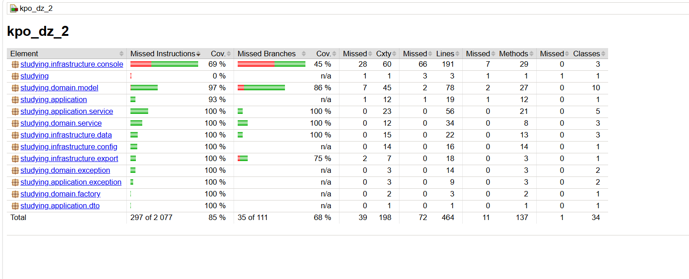

# ПОС

## Запуск

**Версия Java**: 25.

**Сборка с тестами и чекстайлом**: .\gradlew.bat :kpo_dz_2:build (Windows) ./gradlew :kpo_dz_2:build (Linux / macOS).

**Запуск приложения**: .\gradlew.bat :kpo_dz_2:run --console=plain (Windows) ./gradlew :kpo_dz_2:run --console=plain (Linux / macOS).

**Тесты и покрытие**: .\gradlew.bat :kpo_dz_2:test (Windows) ./gradlew :kpo_dz_2:test (Linux / macOS).  Путь к отчёту о покрытии тестами: kpo_dz_2/build/reports/jacoco/test/html/index.html

**JAR**: .\gradlew.bat :kpo_dz_2:bootJar (Windows) ./gradlew :kpo_dz_2:bootJar (Linux, macOS). Запуск из корня репозитория: java "-Dfile.encoding=UTF-8" "-Dstdout.encoding=UTF-8" -jar kpo_dz_2\build\libs\kpo_dz_2.jar (Windows), java -Dfile.encoding=UTF-8 -Dstdout.encoding=UTF-8 -jar kpo_dz_2/build/libs/kpo_dz_2.jar (Linux / macOS).

Примечание: Если в консоли Windows некорректно отображаются русские буквы, можно перед запуском прописать:

chcp 65001 
[Console]::OutputEncoding = [System.Text.Encoding]::UTF8

## Логика решений

При выполнении задания я использовала архитектуру Ports and Adapters, чтобы однозначно разделить бизнес-логику (логика ПОС) и сервисы (сервисы для работы с оценками, студентами, рубрикой), также как источники данных (репозитории) и условный пользовательский интерфейс  (логика работы с консолью). Кроме того, с целью соблюсти DDD, я провела чёткое разделение на то, что должно быть реализовано в домейне, инфраструктуре и приложении.

Для тестирования я прибегла к юнит тестам и интеграционным тестам (DIIntegrationTest, AppConfigTest), так как использование моков было бы излишним. В моей программе можно проследить соблюдение принципа DI в общей конфигурации с использованием Spring (@Configuration, @Bean), чтобы обеспечить единственное место, где собирается граф объектов. Всего тестами покрыто 85% инструкций.

Примечание: в основном тестами не покрыты только Main и часть консоли. Тесты сосредоточены на проверке правильно отработанных исключений и правильности выполнения.

Результаты (итог ПОСа - список студентов и их оценок) экспортируется в csv-файл results.csv.

Примечание: при запуске через run results.csv окажется в папке kpo_dz_2, а через java -jar - в текущей папке.

Из прочих решений:

   - шкала итога принимает значения от 0 до 100;
   - для более точных расчётов и округления используется BigDecimal вместо обычного double;
   - если какая-то оценка не стоит, то по умолчанию она считается за ноль (AverageRule), однако можно воспользоваться и другим правилом, чтобы расчёт проходил только по проставленным оценкам (RatedOnlyRule), а при пропущенной оценке общий итог не портился. Выбрать правило можно в AppConfig. 
   - на пару студент-критерий можно поставить только одну оценку, повторная заменяет предыдущую, а также оценку можно удалить;
   - рубрикатор один;
   - итог не хранится, а вычисляется;
   - в программе есть два вида ошибок: доменные и непосредственно самого приложения.

## Карта DDD

1) **Ubiquitous Language**: названия, используемые в коде, в коде полностью соответствуют предметной области: студент => Student, критерий => Criterion, оценка => Estimate, итог => Total.

2) **Entity и Value Object**: в коде присутствует чёткое разделение: все value objects, такие как Estimate, Score, MaxScore, Weight, Total являются рекордами, так как их задача - защищать инварианты, они неизменяемые и содержат логику; в то же время сущности (entity), такие как Student, Criterion, Rubric (корень агрегата) - это классы, требующие своих методов и их определённой реализации. Пример различия: если имеется два Score(5), то они равны и взаимозаменяемы, а два студента с одним именем разные, так как у них отличается id. Что касается границ агрегатов, рубрикатор (Rubric) - корень агрегата со своими критериями, студенты - это отдельная сущность, на них ссылается оценка (Estimate) по id.

3) **Инварианты**:

    - _балл не выходит за пределы критерия_ => класс Rubric, отвечающий за рубрикатор, содержит метод checkScore, проверяющий это условие;
    - _оценку можно выставить только по критерию из рубрикатора_ => Rubric содержит метод criterion, возвращающий критерий при его наличии и бросающий ошибку CRITERION_NOT_IN_RUBRIC при его отсутствии в рубрикаторе;
    - _итог согласован с текущим набором оценок (считается в Domain Service)_ => в папке service в домейне есть класс TotalCalculator, он и отвечает за подсчёт итога по рубрике и оценкам студента;
    - балл всегда не отрицательный, максимум и вес - положительные (проверяется в соответственных рекордах - Score, MaxScore, Weight);
    - итог находится в диапазоне [0, 100] (проверяется в Total).
   
4) **Repository (порт)**: выделена отдельная папка infrasctructure/data вне domain, которая содержит реализацию работы с репозиториями для хранения представителей каждой сущности. В контексте архитектуры "Порты-адаптеры", это является адаптером, а порт - это интерфейс в domain/repository.

5) **Domain Service**: в домейне тоже есть собственный сервис - TotalCalculator, который осуществляет подсчёт итога. AverageRule, RatedOnlyRule - это стратегии правила. Кроме того, подсчёт итога не принадлежит одной сущности, так как использует и рубрикатор, и оценки

## Архитектура и слои

**Выбранная архитектура**: "Порты-адаптеры". В центре - домейн: сущности и VO + проверка инвариантов (модели), фабрика оценок, сервисы домейна, интерфейсы репозиториев (но их реализация однозначно за пределами домейна). Структура: domain/exception, domain/factory, domain/model, domain/repository, domain/service. Снаружи - application (DTO (application/dto), порт (application/port), реализация паттерна "фасад", свои сервисы (application/service) + application/exception), infrastructure (реализация репозиториев (infrastructure/data), экспорта (infrastructure/export), конфигурации(infrastructure/config) и работы с консолью(infrastructure/console)). Main лежит в пакете studying.

Зависимости направлены внутрь: инфраструктура зависит от портов (на этом и заложена архитектура "Порты-адаптеры"), DI обирает граф объектов в едином месте (infrastructure/config/AppConfig.java) с помощью @Configuration и @Bean.

Стрелка зависимостей: infrastructure -> application -> domain.

## Обоснование GoF

**Используемые паттерны**:

1) Порождающие - фабрика: здесь мы её использовали для создания оценок (EstimateFactory). С её помощью мы инкапсулируем инициализацию оценок: создание оценки требует проверки по рубрикатору, и фабрика обеспечивает единую точку создания с инвариантами, чтобы эту проверку не нужно было повторять во всех местах.

2) Структурные - фасад: здесь фасад проявлен довольно слабо, мы использовали его для создания единой точки сценариев ПОСа для консоли (POSFacade). Так, этот паттерн сильно упрощает работу взаимосвязанных компонентов (в нашем случае сервисов и отдельных методов, например, по подсчёту или выставлению оценки), поместив её в одну точку входа. Проще говоря, консоль зависит от одного объекта вместо четырёх сервисов.

3) Поведенческие - стратегия: мы использовали этот паттерн для создания определённых правил для расчёта итога. Таким образом мы избавились множества уловных конструкций (if-ов или switch-case-ов) и усложнённого тестирования логики подсчёта, вместо этого её мы поместили в конкретные правила. 

## Роль ИИ

Выполнение этого задание я разделила на логические этапы (начиная с реализации моделей и заканчивая написанием реализацией консольного интерфейса и главной функции), на каждом из которых я консультировалась с ИИ и писала код, используя свои решения, а также уточнения и подсказки ИИ и отправляла ему на проверку. Кроме того, логику разделения по DDD и архитектуру "Порты-адаптеры" я проработала сама, однако ИИ помог определиться с выбором конкретных паттернов GoF. При написании тестов я изначально планировала воспользоваться моками (используя @Bean), но ИИ преложил обойтись юнит- и интеграционными тестами, но воспользоваться @Bean при написании AppConfig. Написание кастомных ошибок, интерфейсов, большинство коротких классов и рекордов было выполнено мной (при проверке ИИ исправлял ошибки, если они были), а написание более длинных файлов было дополнено ИИ (например, AverageRule.java, EstimateService, ResultService). Написание Main и файлов, обеспечивающих вывод в консоль я поручила ИИ, также как и экспортер в csv. ИИ был использован дял правок в грейдл (в основном мелких, по типу правок для корректного отображения русских букв в терминале, а так файл грейдл был взят с семинарских практик). Написание тестов я посчитала рутинной работой, поэтому эта часть тоже была поручена ИИ (однако мне пришлось добавить в них DisplayNames, так как они отсутствовали), и для практики я также написала 1-2 небольших тестов сама. Также изначально ИИ не использовал @Lombok в написании классов, а я использовала, поэтому я попросила ИИ тоже использовать его. 
